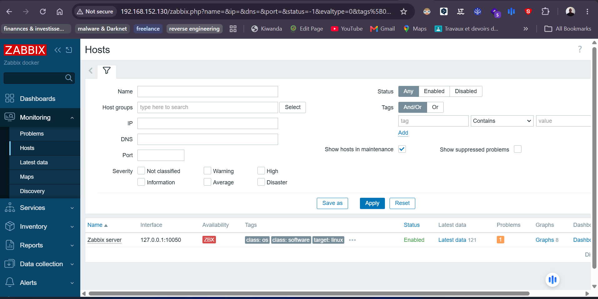

# ZABBIX POUR LA SUPERVISON

**Objectif :** Ce projet a pour but de mettre sur pied un serveur de supervision afin de suivre l'ensemble de notre infrastructure (réseau, système, cloud, applications). 


### I- PERIMETRE 
Ce projet ce structure en trois partie. Une pour la supervision système, une pour réseau et une pour les applications. Même comme, à la fin il s'agit juste d'une supervision système quelle soit faite via des agents (passifs ou actifs) ou via le protocole snmp (simple network management protocol) avec des OID(Object Identifier ou identifiant d'objet) en fonction de la plateforme (Linux, cisco, fortigate, mikrotik, windows, etc) sur laquelle nous effectuons la surveillance. 

<p align="center">
  
</p>


### II- PREREQUIS
Bien que ce readme a pour but de donner des indications sur comment le reproduire, ainsi que les commentaires dans les fichiers yaml (.yml) qui vise à faciliter la compréhension. Il est important que vous ayez des notions en **containeurisation, orchestration de container, langage yml, les notions autours de la supervision (agents, scrapping, vérifications, etc)**. Il faut aussi avoir installé et configuré sur une **VM/VPS/VDS** Linux le necessaire suivant :
- Docker et Docker compose ;


### III- MISE EN PLACE DU SERVEUR ZABBIX


Pour mettre en marche nos outils :
1) Modifier l'adresse IP définit dans nos fichiers de configuration et remplacer par l'IP de votre server.

2) Démarrage de zabbix serveur 
```powershell
# Passer en mode superutilisateur
- sudo -s

# Installation et démarrage de prometheus et du nécessaire (exporteurs)
- docker compose -f compose-zabbix-server.yml up -d

# Vérifier que les conteneurs (mysql, zabbix-server, zabb)
- docker container ls 

# Pour recreer nos conteneurs si vous vous êtes trompés dans l'ordre d'exécution
docker compose -f compose-zabbix-server.yml up -d --force-recreate
```


x) Accéder à l'interface graphique de zabbix :
    - Pour l'interface web de Zabbix : http://votre_ipv4:80. Le Username par défaut est **Admin** et le password **zabbix**. Il est important de changer ces informations quand nous voudrions passer en production. 
    


    
**NB :** Il faudra exécuter les commandes ci-dessus dans le terminal en étant à la racine du projet. 


